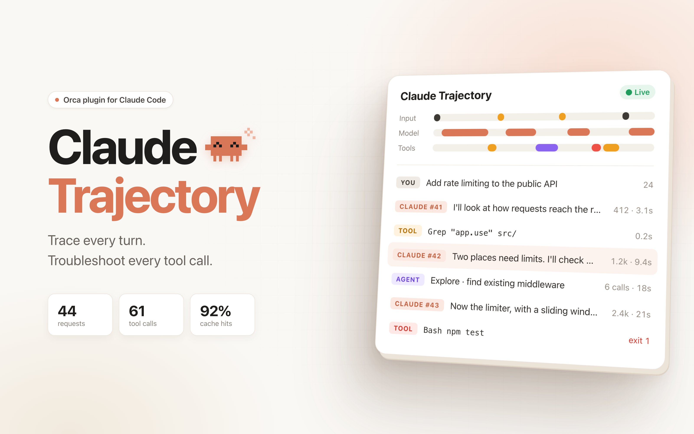

# Claude Trajectory for Orca

[](LICENSE)



An [Orca](https://github.com/stablyai/orca) sidebar panel that shows what a [Claude Code](https://claude.com/claude-code) session did, request by request, oldest first:

- **FIXED**: what every request carries before the conversation, estimated from the first request. Select it to open it by category: system prompt, built-in tools, MCP tools by server, MCP instructions, memory files, skills, agents, deferred tool names.
- **Turn N**: each prompt you typed (**YOU**), each request Claude Code sent the model (**CLAUDE**, with input/output tokens, cache hit, time to first block, duration and end-to-end tok/s), and the tool calls each request made (**TOOL**, or **AGENT** with the subagent's own calls under it). Requests that a background event started rather than a prompt (a finished task, a CI event) sit in a group of their own, not numbered as a turn.
- **Lanes**: Input, Model, Tools and Agents, drawing the newest events in order.
- **Toolbar**: fold or open every turn at once, and leave out **Calls** or **Subcalls**. A folded turn still says what its prompt was. Calls made by an agent that another subagent started show under the first Agent call, and say which agent made them.
- **Details**: select a row for its Summary, Input, Result or Timing.
- **Export**: saves the trajectory as text (figures, tools and what they were about; no prompt, reply, input or output text).

It follows the session live: the panel updates as the transcript grows.

It reads **Claude Code** sessions only. Other agents (Codex, Gemini CLI and so on) keep their sessions elsewhere, in other formats.

This is the Usage room's Trajectory card from [squad-chat](https://github.com/chrisluo5311/squad-chat), moved to Orca on its own.

## How it works

Claude Code writes each session to `~/.claude/projects/<folder>/<session-id>.jsonl` (or under `$CLAUDE_CONFIG_DIR`). The plugin's worker finds the focused Orca workspace's sessions there, reads the chosen one **read-only**, and sends the panel a summary of it. Subagents are read from `<session-id>/subagents/`.

Squad-chat measured requests as they streamed. Here they are rebuilt from the transcript, so:

- A request's start is when Claude Code logged it, and "first block" is when its first content block was written whole: later than the first token. So speed is shown end to end (output tokens over the whole request), not as generation speed.
- The fixed overhead is an estimate: the first request's input less what its prompt added. Its categories share that figure out by the size of each part's text, from the transcript's `api-request-shape` and `attachment` lines. Only names and sizes are read from those, and a session whose transcript has no such lines shows the total alone.
- A prompt's and a tool result's tokens are the next request's growth, spread by size.

## Install

Orca 1.4.248 or newer.

```sh
orca plugin install https://github.com/chrisluo5311/orca-claude-trajectory   # once published
# or, from a checkout:
orca plugin dev load /path/to/orca-claude-trajectory
```

Orca asks you to approve it. It asks for:

| Access | Why |
| --- | --- |
| Runs a worker (trusted-worker) | To read Claude Code transcripts on disk. It only reads; see [Security](#security). |
| `workspace:read` | To know which workspace is focused and where its folder is. |
| `agent:read` | To refresh when an agent's status changes. |

Open it from the right sidebar (the activity icon), or `orca plugin open local.claude-trajectory --panel trajectory` (`<owner>.claude-trajectory` once installed from GitHub).

## Security

The panel shows parts of your own transcripts, which can hold secrets. What the plugin does about that:

- **Read-only, local.** The worker never writes a file, runs a command, or opens a network connection. It has no dependencies.
- **Only Claude Code's transcripts.** The panel names a workspace and a session by id; the worker accepts only ids it listed itself and never takes a path from the panel. File names must match strict patterns, symbolic links are refused, real paths must stay under the projects folder, and files are opened with `O_NOFOLLOW`.
- **Only sessions that ran there.** A session is shown for a workspace only when its transcript says it ran in that workspace's folder.
- **Short, masked previews.** The panel gets at most 200 characters of a prompt or reply, 8 input fields of 160 characters, and 3 lines of a result. Anything that looks like a secret (API keys, tokens, private keys, passwords in URLs, `*_SECRET=` assignments, JWTs) is hidden whole. Control characters and bidi overrides are stripped.
- **No HTML.** The panel is a components panel: Orca draws every control, so transcript text can only appear as text. It renders no Markdown, links or images from transcripts.
- **Bounded work.** At most the newest 32 MiB of a transcript, 4 MiB per subagent, 60 requests, 200 names per FIXED category, and a 384 KiB answer are read or sent. The secret patterns are bounded against slow-regex input.

Masking is a best effort, not a guarantee: don't share screenshots of the panel without looking at them first. Report vulnerabilities as described in [SECURITY.md](SECURITY.md).

## Development

No build step: Orca loads `src/` as written.

```sh
orca plugin dev watch . --check --shot .orca/shots   # load, reload on save, render checks
orca plugin test . --json                            # unit tests (node:test)
orca plugin check . --json                           # render the panel's scenarios
npm install && npm run typecheck                     # optional: type-check with tsc
```

| File | What it does |
| --- | --- |
| `src/worker.ts` | Answers the panel; watches the transcript. |
| `src/locate.ts` | Finds and reads transcripts safely. |
| `src/transcript.ts` | Turns transcript lines into the trajectory. |
| `src/redact.ts` | Cleans and masks every preview. |
| `src/panel.tsx` | The panel. |
| `src/format.ts` | Figures and the exported text. |

## License

MIT
